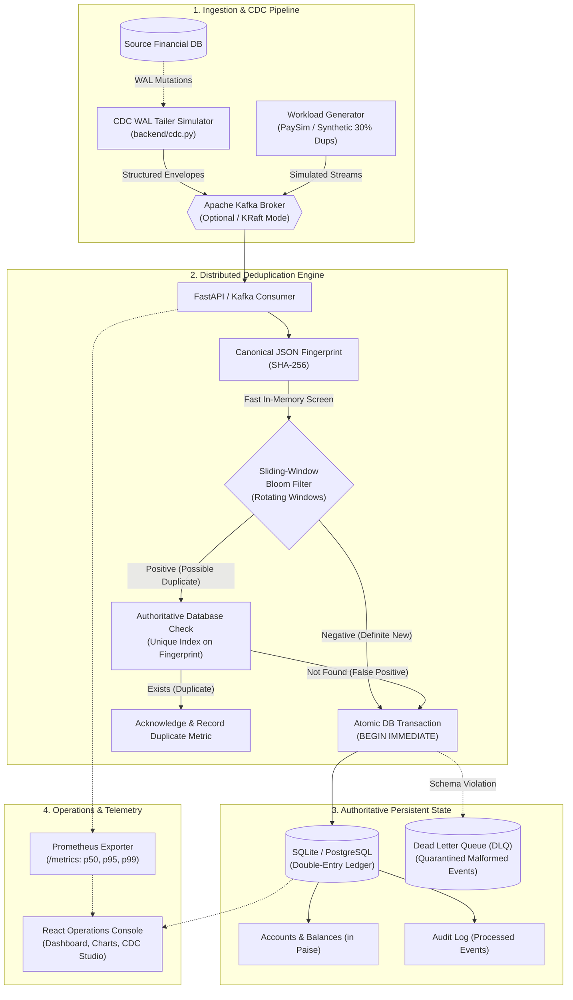

# PS-15: Exactly-Once Event De-duplication Engine

A production-grade, local-first event deduplication engine demonstrating how financial transfers maintain **strict exactly-once semantics** (zero double-spending, 100% duplicate recall) under high concurrency, burst deliveries, and simulated network retries.

Built with **FastAPI**, **SQLite / PostgreSQL**, a **canonical SHA-256 fingerprint**, a multi-sliced rotating **sliding-window Bloom filter**, and an authoritative **double-entry ledger** with atomic SQL transaction boundaries. Includes a modern **React Operations Console**, **CDC (Change Data Capture) simulator**, and **PaySim financial benchmark suite**.

---

## Architecture Blueprint



---

## Collaborator Quickstart (No Manual Data Transfer Needed!)

> [!NOTE]
> **No manual dataset or database files need to be sent.**
> - **Database (`ps15.db`)**: Automatically created and initialized with all tables, constraints, and indexes on first boot.
> - **PaySim & Banking Datasets**: Procedurally synthesized on-the-fly via built-in generators (`scripts/generate_paysim.py` and `scripts/generate_transactions.py`).

### Prerequisites
- **Python 3.10+** (Python 3.11, 3.12, or 3.14)
- **Node.js 18+** & **npm**
- *(Optional)* **Docker Desktop**

---

### Option A: Run Locally (Recommended for Development)

#### 1. Clone & Set Up Backend

```powershell
# Clone the repository
git clone <REPO_URL>
cd deduplication

# Create virtual environment (optional but recommended)
python -m venv .venv
# Windows PowerShell:
.\.venv\Scripts\Activate.ps1
# macOS / Linux:
# source .venv/bin/activate

# Install dependencies
pip install -r requirements.txt

# (Optional) Copy environment template
cp .env.example .env

# Launch FastAPI backend
uvicorn backend.main:app --reload --port 8000
```
- **Backend API**: `http://localhost:8000`
- **Interactive Swagger Docs**: `http://localhost:8000/docs`
- **Prometheus Telemetry**: `http://localhost:8000/metrics`

#### 2. Launch React Operations Console

In a **second terminal**:

```powershell
cd frontend
npm install
npm run dev
```
- **Operations Console**: `http://localhost:5173`

---

### Option B: Run via Docker Compose (Zero Configuration)

#### Minimal Profile (Lightweight, SQLite)
Runs backend and frontend with zero external dependencies:
```powershell
docker compose up --build
```

#### Distributed Profile (Production Stack)
Spins up PostgreSQL 16, Apache Kafka 3.7 (KRaft mode, zero Zookeeper), consumer workers, backend, frontend, and Prometheus:
```powershell
docker compose --profile distributed up --build
```

---

## Automated Verification & Chaos Testing

### 1. Run Complete Test Suite
Executes all 17 unit, integration, and concurrency invariant tests:
```powershell
python -m pytest
```

### 2. Run Chaos & Fault-Injection Suite
Tests race conditions, multi-threaded duplicate floods (16 workers), out-of-order arrivals, and verifies double-entry ledger balance:
```powershell
python scripts/chaos_injection.py --total 500 --duplicate-rate 0.30 --concurrency 16
```

### 3. Generate PaySim Workload via CLI
Generate a deterministic 1,000-record PaySim financial workload with 30% duplicate injection:
```powershell
python scripts/generate_paysim.py --output data/paysim_demo.csv --total 1000 --duplicate-rate 0.30
```

---

## Operations Console Features (`http://localhost:5173`)

1. **Operations Dashboard**:
   - Live KPI cards: Ingested deliveries, committed transactions, duplicates prevented, DLQ count, and p95 latency.
   - Interactive pipeline visualizer showing end-to-end data flow.
   - Real-time Recharts area graph rendering live **p50, p95, and p99 latency** percentiles.
   - Ingestion feed with one-click **Replay** button to test idempotent rejection.
2. **CDC & WAL Streamer**:
   - Interactive database mutation generator simulating PostgreSQL WAL tailing.
   - Configurable event volume, duplicate rate, and broker retry burst injection.
   - Real-time Log Sequence Number (`LSN`) inspection table.
3. **Transaction Studio**:
   - Single transfer submission with account generator.
   - "Trigger 30% Duplicate Burst" button simulating rapid duplicate flooding.
4. **Dead Letter Queue (DLQ)**:
   - Quarantines malformed payloads and schema violations.
   - Individual one-click redrive, bulk redrive, or discard.
5. **Workload Benchmarks**:
   - PaySim Kaggle and synthetic dataset selection.
   - Real-time progress bar, throughput (TPS) calculation, and duplicate precision/recall metrics.
6. **Cloud Architecture & Safety Guide**:
   - Production AWS vs. $0 Student Free-Tier service mapping.
   - RBI-compliant Indian debit card ₹2 INR verification & refund instructions.
   - AWS Budgets zero-spend $1.00 setup guide.
   - Live `/metrics` Prometheus text viewer and demo state reset.

---

## API Reference

| Method | Endpoint | Description |
| :--- | :--- | :--- |
| `GET` | `/health` / `/health/ready` | Liveness and readiness probes |
| `GET` | `/metrics` | Prometheus OpenMetrics exporter (p50/p95/p99 latency, counts) |
| `GET` | `/api/v1/dashboard/summary` | Consolidated dashboard summary (counts, Bloom state, latency) |
| `POST` | `/api/v1/events` | Ingest single financial transaction event |
| `POST` | `/api/v1/events/batch` | Ingest batch of events (up to 1,000 records) |
| `POST` | `/api/v1/events/{event_id}/replay` | Replay an existing event to test idempotent duplicate detection |
| `POST` | `/api/v1/cdc/simulate` | Trigger simulated Change Data Capture WAL stream |
| `GET` | `/api/v1/dlq` | List quarantined Dead Letter Queue items |
| `POST` | `/api/v1/dlq/{id}/redrive` | Attempt re-processing of a DLQ event |
| `POST` | `/api/v1/dlq/redrive-all` | Batch redrive all unresolved DLQ items |
| `POST` | `/api/v1/jobs` | Queue background PaySim or synthetic benchmark job |
| `POST` | `/api/v1/demo/reset` | Reset SQLite tables and clear Bloom filter state |

---

## Kubernetes Orchestration (`k8s/`)

Deploy to any Kubernetes cluster (Minikube, k3s, EKS):

```powershell
# 1. Apply configuration and secrets
kubectl apply -f k8s/configmap.yaml
kubectl apply -f k8s/secret.example.yaml

# 2. Deploy PostgreSQL cluster storage
kubectl apply -f k8s/postgres.yaml

# 3. Deploy API backend and consumer workers
kubectl apply -f k8s/backend-deployment.yaml
kubectl apply -f k8s/backend-service.yaml
kubectl apply -f k8s/worker-deployment.yaml

# 4. Deploy Horizontal Pod Autoscalers and Ingress
kubectl apply -f k8s/hpa.yaml
kubectl apply -f k8s/ingress.yaml
```

---

## License

Academic and educational evaluation under MIT License.