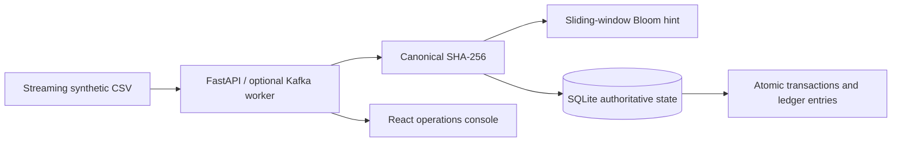

# PS-15: Exactly-Once Event De-duplication Engine

This local-first academic project demonstrates how a financial transfer remains a single financial effect when an event is delivered repeatedly or concurrently. It uses FastAPI, SQLite, a canonical SHA-256 fingerprint, a rotating Bloom filter for screening, and database uniqueness plus an atomic transaction for authoritative protection.

## Architecture



The Bloom filter can only say “possibly seen”; it never rejects an event by itself. The persistent database and transaction ID uniqueness are the correctness boundary. A replay after a filter reset is still prevented.

## Windows direct mode

From `C:\Users\Lakshmikant\Desktop\ACC`:

```powershell
python -m venv .venv
.\.venv\Scripts\Activate.ps1
python -m pip install --upgrade pip
python -m pip install -r requirements.txt
Copy-Item .env.example .env
python -m uvicorn backend.main:app --reload --host 127.0.0.1 --port 8000
```

In a second PowerShell terminal:

```powershell
cd frontend
npm install
npm run dev
```

Open `http://localhost:5173` and API docs at `http://localhost:8000/docs`. If activation is blocked, use `.\.venv\Scripts\python.exe -m pip install -r requirements.txt` and `.\.venv\Scripts\python.exe -m uvicorn backend.main:app --host 127.0.0.1 --port 8000`.

## GitHub safety

The repository intentionally excludes `.env` files, virtual environments, `node_modules`, build output, SQLite databases, generated CSV workloads, logs, caches, and editor metadata. Commit `.env.example`, never `.env`. The Kubernetes secret file is an example containing only a placeholder; replace it through your cluster's secret-management workflow rather than committing credentials.

## Demonstration

```powershell
python scripts\generate_transactions.py --output data\demo.csv --total 1000 --duplicate-rate 0.30 --invalid-rate 0.01 --seed 42
```

The generated CSV is deterministic and streams rows to disk. It contains approximately 69% unique valid records, 30% duplicate deliveries retaining the original IDs, and 1% invalid rows. `ground_truth` is evaluation metadata and is not part of the fingerprint. The benchmark reports ground-truth duplicate precision and recall in addition to throughput and duration. Submit an event twice from the Transactions page or Swagger to see one commit and one duplicate. Invalid records are recorded in the DLQ.

Run tests with:

```powershell
python -m pytest -q
```

GitHub Actions runs the backend test suite and frontend production build on every push and pull request.

## API

* `GET /health` and `GET /health/ready`
* `POST /api/v1/events` and `/api/v1/events/batch`
* `GET /api/v1/dashboard/summary`, `/api/v1/metrics`, `/api/v1/events`, `/api/v1/dlq`
* `POST /api/v1/events/{event_id}/replay`
* `POST /api/v1/demo/reset`
* `POST /api/v1/jobs`, `GET /api/v1/jobs`, `GET /api/v1/jobs/{job_id}`

## Docker and optional Kafka

`docker compose up --build` runs the local frontend and backend without AWS, Kafka, or PostgreSQL. The included Kafka worker uses `confluent-kafka`, manual commits, and the same `DeduplicationEngine`; configure `KAFKA_BOOTSTRAP_SERVERS`, `KAFKA_TOPIC`, and `KAFKA_GROUP_ID` only when a broker is available. SQLite is intentionally for simple local mode and is not shared storage for arbitrary replicas.

Kubernetes manifests can be used around the stateless API with a shared PostgreSQL database. Kafka's at-least-once delivery alone is not exactly-once financial processing; the database idempotency boundary is required. Actual CDC/WAL tailing and AWS deployment are future integrations, not claimed features.

The supplied `k8s/` files are local-cluster templates. Build `ps15-backend:latest` and `ps15-frontend:latest`, apply `configmap.yaml`, then the deployments and services. Keep the worker at zero until Kafka and shared persistence are configured; `kubectl scale deployment ps15-worker --replicas=2` is the documented recovery/scaling exercise once those dependencies exist.

## Metric definitions and limitations

This is fictional educational data, not a banking system. Amounts are validated as decimal INR and stored as integer paise. Total deliveries include valid, duplicate, and invalid input. Throughput is deliveries divided by monotonic processing duration. Duplicate precision is true duplicate classifications divided by all duplicate classifications; recall is true duplicate classifications divided by known duplicate rows. The Bloom filter is probabilistic and bounded; persistent state is retained so filter aging, reset, or application restart cannot reapply a transaction. Large jobs should be processed from CSV in bounded batches rather than loaded into browser memory.